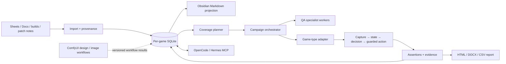

# แผนพัฒนา UGAF Studio: Game QA, Memory และ AI Team

วันที่จัดทำ: 10 ตุลาคม 2026  
เป้าหมาย: ทำให้ UGAF Studio เป็น QA Workbench ที่ต่อยอดหลายเกม/หลายประเภทได้ โดยมีผลทดสอบตรวจสอบย้อนกลับได้ และให้ agent เล่นอัตโนมัติได้เฉพาะขอบเขตที่ผ่านเกณฑ์รองรับแล้ว

## สถานะปัจจุบันจาก codebase

- มี SQLite แยกตาม game profile เก็บเกม, story scenes/links, choices, subtitle cues, testcases, runs/results, feedback, evidence, source sheets และ game memory
- มีตัวนำเข้า Google Sheets/Docs แบบ read-only, Story Timeline, testcase/report และ MCP tools ที่อ่าน profile memory กับ source sheet ได้
- มี capture, OCR, template/color assertions, bounded gameplay runner, VLM agent และ action cache; มีตัวอย่างแนวทาง FMV, visual novel และ realtime
- มี ComfyUI adapter สำหรับส่งภาพเข้า workflow ที่ผู้ใช้เลือก และมี OCR path ใน Studio Framework; ยังไม่มี workflow registry/health lifecycle หรือเครื่องมือออกแบบ UI ที่ผูกกับ design system
- มี QA Command Center และ specialist briefs 9 บทบาท พร้อม OpenCode/Hermes entry points; แคมเปญหลายเกมและการประสาน worker ยังไม่ใช่ durable orchestrator ที่ทำงานและกู้คืนได้ครบทุกขั้น
- มี memory แบบ facts และ behavioral cache แต่ยังไม่มี Obsidian vault ที่เชื่อม requirement → scene → testcase → run → defect และค้นย้อนกลับแบบ full-text/semantic

ดู implementation ปัจจุบันได้ที่ `app/database/database.py`, `app/qa/story_timeline.py`, `app/qa/workbook_import.py`, `qa_framework/gameplay_agent/`, `qa_framework/gameplay/`, `app/services/comfyui_service.py`, `qa_framework/orchestration/specialists.json` และ `docs/qa-orchestra-team.md`.

## เป้าหมายระบบ

หลักการสำคัญ: SQLite เป็นข้อมูลหลัก (source of truth); Obsidian เป็นมุมมอง Markdown ที่สร้างซ้ำได้ ไม่เก็บสำเนาที่แก้แยกจนข้อมูลขัดกัน ผล `PASS` ต้องมี assertion และหลักฐานจาก build/run ที่ระบุได้ การตัดสินใจที่ยังไม่แน่ใจให้หยุดหรือรายงาน `NEEDS_REVIEW`.

## โหมดการทำงานและเกมที่รองรับ

กำหนด mode ต่อ campaign ไม่ใช่เปิดสิทธิ์จาก prompt อย่างเดียว: `OBSERVE_ONLY` (อ่านภาพ/log ไม่ส่ง input), `PLAN_ONLY` (ออกแบบเส้นทาง/รายงาน), `BOUNDED_RUN` (ส่ง input ภายใต้ profile, step/time budget และ stop control), `UNATTENDED` (อนุญาตเฉพาะ profile/suite ที่ผ่าน acceptance และไม่มี legal/destructive gate). หน้า profile ต้องแสดง build, platform, adapter version, test categories ที่รองรับ, oracle/evidence ที่ใช้, ความสามารถที่ยังขาด และวันผล benchmark.

การเพิ่มแนวเกมให้เพิ่ม capability ใน support matrix ก่อนเขียน strategy; ป้ายประเภทเกมอย่างเดียวไม่พอพิสูจน์ว่า agent เล่นได้.

## ลำดับการพัฒนา

| ลำดับ | ระยะ | ขอบเขต / สิ่งส่งมอบ | เกณฑ์ผ่าน |
|---|---|---|---|
| 0 | ทำฐานให้เสถียร (S) | เวอร์ชัน schema/migration, backup/restore, run ID และ source/build hash, ตรวจ health ก่อนเล่น, กันข้อมูล profile ข้ามเกม; fail-closed เมื่อ action ผิด schema/allowlist; แยก “ภาพเปลี่ยน/เกมเดินต่อ” ออกจาก “test ผ่าน”; cache เฉพาะ action ที่ oracle ยืนยัน | เปิด/อัปเกรด DB เก่าได้โดยไม่เสีย run; profile A อ่านข้อมูล B ไม่ได้; parse error หรือจอไม่รู้จักไม่ส่ง input; สร้าง report เดิมซ้ำได้จาก run artifacts |
| 0.1 | Source sync ที่ตรวจย้อนกลับได้ (S) | ผูกทุก imported scene/edge/cue/case กับ source ID + revision/hash + worksheet/row; sync แบบ transaction/idempotent; ทำ stale/tombstone ให้ relation ที่ถูกลบจากชีต; เก็บ conflict เมื่อ locale/choice ซ้ำแทนเลือกเงียบ | sync ซ้ำได้ผลเดิม; source row ที่ถูกลบไม่ค้างเป็นทางเดิน active; ข้อมูล manual/runtime ไม่ถูก importer ลบ; ตรวจได้ว่าค่าใดมาจากแถวไหน |
| 1 | Game Memory แบบ Obsidian (M) | สร้าง vault แยกเกม: `Games/<profile>/Home.md`, `Sources/`, `Scenes/`, `Requirements/`, `Testcases/`, `Runs/`, `Defects/`; frontmatter มี stable ID, build/source revision, locale, confidence, provenance และสถานะ; เชื่อม `[[scene]]`, `[[testcase]]`, `[[run]]`; ใช้ SQLite FTS5 สำหรับค้นข้อความก่อน เพิ่ม vector search ภายหลังเมื่อมีชุดข้อมูลและ benchmark | export vault ซ้ำแล้วได้ผลเดิม; ทุก fact ย้อนถึง URL/แท็บ/แถว หรือ run/evidence; แก้ใน vault ไม่เขียนกลับชีต; MCP ค้น memory พร้อม citation และ profile scope |
| 2 | FMV vertical slice + testcase (M) | ทำ HighSchoolBloodDemo เป็น adapter แรก: map story graph, 4 ตัวเลือก Go Left และ timeout, Visual Choice, language setting, subtitle timing/locales, scene transition, replay/checkpoint; วาง test matrix ครบทุก choice edge และ minigame ที่ source ระบุ; เสนอ Unreal test bridge แบบ optional/read-only สำหรับ scene, timecode, cue, choice/timer และ minigame state | มี coverage report แยก nodes/edges/choices/locales; timeout test ทำซ้ำได้; subtitle failure ชี้ cue/key/time/evidence; ไม่ถือว่าเปลี่ยนภาพคือผ่าน; black-box mode ยังทำงานเมื่อไม่มี plugin |
| 3 | Decision AI และ game adapters (L; ทำทีละ genre) | กำหนด `GameAdapter` contract: discover/launch, capture, state extraction, allowed actions, reset/checkpoint, success oracle และ cleanup; ทำ adapter FMV → visual novel → turn-based/puzzle → real-time/action; perception มี fast path (state/OCR/rules/cache) และ VLM fallback เฉพาะ state กำกวม; planner คำนวณเส้นทางที่ยังไม่ coverage; executor ตรวจ allowlist, bounds, timeout และ stop key | แต่ละ adapter มี capability matrix + benchmark set + failure/recovery rate; action cache บันทึกผลหลังตรวจ outcome เท่านั้น; unknown state, stuck budget หรือ mismatch หยุดได้; agent ไม่ได้รับสิทธิ์เกิน adapter |
| 4 | QA report และ defect loop (M) | สร้าง report เดียวจาก testcase, run manifest, action trace, screenshot/video/audio evidence, expected/observed, build/source revision; export HTML/DOCX/CSV; feedback ผูกกับ defect และ testcase พร้อมสถานะ draft/reviewed/fixed/retest | ผู้ตรวจเปิดรายงานแล้วทำซ้ำได้; ไม่มี PASS ที่ขาด assertion/evidence; patch note ใหม่ระบุ test ที่กระทบและ coverage ที่ต้อง rerun; feedback ที่ยังไม่ตรวจไม่กลายเป็น memory ที่เชื่อถือสูง |
| 5 | ComfyUI Design & Vision Workbench (M) | ทำ workflow registry แยกงาน `ui_mockup`, `screen_annotation`, `visual_review`; เก็บ workflow/model/node version, input/output hash, prompt และผลใน evidence; ใช้สร้าง mockup/annotated reference และช่วยจัดกลุ่มภาพ; UI จริงยังเป็น Qt component ที่ทีมพัฒนาและตรวจ accessibility/การใช้งาน | workflow ตรวจ `/system_stats`, dependency และ model ที่ต้องใช้ก่อน; ผลทุกชิ้นผูก workflow/version; mockup ไม่ถูกใช้เป็น expected image จน reviewer อนุมัติ; ไม่มี ComfyUI ก็ยังเล่น test แบบ deterministic ได้ |
| 6 | AI Team Office / Orchestrator (L) | campaign state machine: intake → source/coverage review → case design → automation readiness → preflight → bounded execution → independent evidence audit → release report; roles จาก specialists registry; worker adapters สำหรับ OpenCode/Hermes; durable queue, timeout/retry budget, lease/lock, cancellation/resume, audit log และ result schema กลาง | จำลอง worker สำเร็จ/ล้ม/timeout/restart ได้; งานซ้ำไม่สร้าง run หรือ defect ซ้ำ; มีผู้ควบคุม input เกมได้เพียงหนึ่งตัว; campaign ระบุ agent ที่รันจริงและ citation; worker เสนอ action ได้แต่ไม่มีสิทธิ์ bypass safety gate |
| 7 | แพ็กเกจและการดูแลระยะยาว (M) | installer/update channel, preserve user DB, schema upgrade/rollback, Comfy/VLM/OCR health check, game profile setup wizard, local backup/export, log retention และ privacy controls | clean machine ติดตั้งและเปิด sample profile ได้; update เก็บ DB/รายงานผู้ใช้; แสดง missing dependency เป็นสถานะชัด ไม่ค้างหรือรายงาน PASS; มี restore drill ก่อน release |
| 8 | Robot Framework + Decision API (M) | keyword library สำหรับ capture/OCR/color/input; local VLM decision HTTP API; Robot XML/HTML + manifest; tag/variable selection; bounded actions, screenshot provenance, foreground title guard; bridge Robot results กับ profile testcase DB และ packaged workers | mock API กับ real Robot suite ผ่าน; invalid/stale/unbounded decisions ไม่ส่ง input; focus drift หยุด run; input ต้องเลือก game title; tag selection/build version/report/evidence traceable; full testcase export/API integration verified |
| 8 | Robot Framework + Decision API (M) | keyword library สำหรับ capture/OCR/color/input; local VLM decision HTTP API; Robot XML/HTML + manifest; tag/variable selection; bounded actions, screenshot provenance, foreground title guard; bridge Robot results กับ profile testcase DB และ packaged workers | mock API กับ real Robot suite ผ่าน; invalid/stale/unbounded decisions ไม่ส่ง input; focus drift หยุด run; input ต้องเลือก game title; tag selection/build version/report/evidence traceable; full testcase export/API integration verified |

ขนาดงาน S/M/L เป็นการประเมินสัมพัทธ์ ไม่ใช่กำหนดส่งตายตัว แต่ละระยะควรส่งมอบเป็น vertical slice และวัดผลก่อนเพิ่ม genre/model ใหม่

## ออกแบบ Memory ให้ใช้กับ agent ได้

1. **ข้อมูลหลักใน SQLite:** ใช้ stable IDs และ migrations; เพิ่ม relation tables สำหรับ requirement, source citation, scene edge, testcase, run, evidence, defect และ reviewed lesson แทนการซ่อนทุกอย่างใน JSON ก้อนเดียว
2. **Obsidian เป็น projection:** สร้าง Markdown พร้อม frontmatter และ wikilink จาก DB; เพิ่ม backlink/index และ graph view; export/import แยกจาก source sync เพื่อป้องกันแก้ทับ Google Sheets
3. **Provenance + ความเชื่อมั่น:** แยก fact ที่ดึงจากเอกสาร, inference จากตำแหน่ง cell, observation จาก run และ feedback ที่มนุษย์ review; บันทึก source revision/hash, เวลา, author/agent, confidence และ validity
4. **Retrieval:** เริ่มจาก exact ID + FTS5; ใช้ vector/embedding ต่อเมื่อ benchmark แสดงว่าช่วยค้นคำถามที่ FTS หาไม่พบ; ทุกคำตอบของ agent ต้องคืน citation ไปยัง source/run
5. **แยกเกม/เวอร์ชัน:** memory key ต้องอยู่ใต้ game profile และ build/source revision; ห้ามนำ action จากเกมหรือเวอร์ชันหนึ่งไปใช้กับอีกเกมโดยไม่มี compatibility match

## รูปแบบ Decision AI ที่เร็วและควบคุมได้

ใช้ agent หลายระดับแทนการส่งทุกเฟรมให้ VLM:

1. `Capture` เก็บภาพ/เสียง/หน้าต่างเกม พร้อมตรวจ stale frame และ input focus
2. `State estimator` รวม scene ID, OCR/subtitle, visual features, timer และ confidence เป็น state ที่มี timestamp
3. `Planner` เลือก testcase/เส้นทางที่ยังไม่ coverage โดยให้ adapter เป็นผู้กำหนด action ที่ถูกกฎหมาย
4. `Policy` เลือก rule/cache ที่ผ่าน outcome ก่อน; เรียก VLM เมื่อ state กำกวม; ตรวจ JSON schema, action allowlist, พิกัดจอ และ step/time budget ก่อนส่ง
5. `Executor + verifier` ส่ง input หนึ่ง action ต่อครั้ง แล้วจับภาพ/ตรวจ assertion เพื่อยืนยันผลและอัปเดต memory

เป้าความเร็วให้วัดบนเครื่องและ VLM endpoint จริง: รายงาน p50/p95 ของ capture, OCR, decision, input, recovery และ time-to-report; optimize fast path ก่อนลดคุณภาพ assertion ห้ามตัด safety check เพื่อให้ benchmark เร็วขึ้น

ทุก release แสดง scorecard อย่างน้อย: in-scope testcase completion, story edge/choice/subtitle/minigame coverage, invalid action rate, unknown-state rate, false-PASS count, evidence completeness, recovery/stuck rate และ latency p50/p95. **False-PASS ต้องเป็นศูนย์** ใน oracle-confirmed regression set ก่อนเปิด `UNATTENDED`; coverage เป็น 100% เฉพาะ subset ที่ประกาศไว้ใน campaign.

## ความหมายของ “อัตโนมัติ 100%”

ทำได้เป็น **100% ของชุดทดสอบที่ประกาศรองรับและมี oracle ชัดเจน** เท่านั้น: agent เลือกและเล่นตาม coverage plan, ตรวจผล, สร้างรายงาน และจบ run ได้เองเมื่อ environment ผ่าน preflight. ไม่ควรรับรองว่า agent เล่นเกมใดก็ได้ทุกแนวหรือวินิจฉัยภาษา/เสียง/ความรู้สึกได้ถูกทั้งหมดโดยไม่มี specification. เกมที่ยังไม่มี adapter, expected result ไม่ครบ, state ไม่รู้จัก หรือผลมีความเห็นเชิงคุณภาพต้องเป็น `BLOCKED/NEEDS_REVIEW`, ไม่ใช่ PASS.

## แผนเริ่มรอบถัดไป

1. **P0:** เพิ่ม schema migration + health check + ปิด cache-on-unverified-action; กำหนด event/artifact contract กลาง
2. **P1:** ทำ memory exporter เป็น Obsidian vault พร้อม backlinks, full-text search และ citation; ยืนยัน import/export/restore บนโปรไฟล์ Demo
3. **P2:** ทำ FMV Demo vertical slice ที่ coverage choice/timer/subtitle/minigame พร้อมรายงาน build-matched
4. **P3:** ทำ benchmark fast path/VLM และ `GameAdapter` contract จากผล Demo ก่อนเปิด genre ที่สอง

ห้ามเริ่ม training/fine-tune หรือ vector database ก่อน P0–P2 มีข้อมูล label ที่ตรวจสอบได้และ baseline วัดคุณภาพ/latencyแล้ว. ComfyUI ไม่ใช่ตัวแทน game adapter หรือ test oracle; AI Team ไม่ควรแก้ source docs หรือส่ง input เกมนอก run ที่มี manifest.

## ช่องว่างที่ต้องปิดก่อนขยายงาน

- **ข้อมูลนำเข้าอาจค้างหรือมีความขัดแย้ง:** ปัจจุบัน scene links และ localization มีการ upsert แบบไม่ผูก source revision จึงต้องทำ source provenance, diff และ stale-link handling ก่อนเชื่อ coverage graph เป็น oracle
- **เกม Unreal ต้องการ state ที่เชื่อถือได้:** vision/OCR อย่างเดียวอาจแยก scene transition, cue key, choice timeout และ minigame result ไม่พอ; ขอ dev-only test bridge เพิ่มได้ แต่เกมยังต้องทดสอบแบบ black-box ได้
- **การเล่นและผล QA เป็นคนละเรื่อง:** การกระทำสำเร็จหรือหน้าจอเปลี่ยนไม่เท่ากับ testcase ผ่าน; cache, memory และ report ต้องแยก action outcome, progression, assertion result และ QA status
- **ComfyUI workflow ต้องกำกับเวอร์ชันและสิทธิ์:** workflow/model ที่นำเข้าเป็น executable graph ควรเป็น trusted/local allowlist, ตรวจ model dependencies และห้าม upload ภาพเกมออกนอกเครื่องโดยไม่มีนโยบายชัด
- **แพ็กเกจต้องทดสอบงานจริง:** ตรวจ frozen worker dispatch, working directory, source/data seed, migration และการเก็บ profile/report หลังอัปเดต ไม่พอแค่เห็นหน้าต่างเปิดขึ้น
- **AI Office ต้องเป็นระบบงานที่กู้คืนได้:** prompt/รายชื่อ role อย่างเดียวไม่ใช่ orchestrator; ต้องมี campaign state, worker result schema, idempotency, timeout/cancel/resume และ audit trail

รายละเอียดงานที่ Codex รับไปทำเป็นลำดับได้อยู่ใน [`codex-execution-brief.md`](codex-execution-brief.md).
